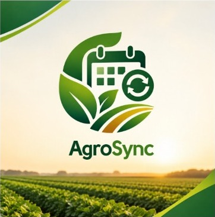
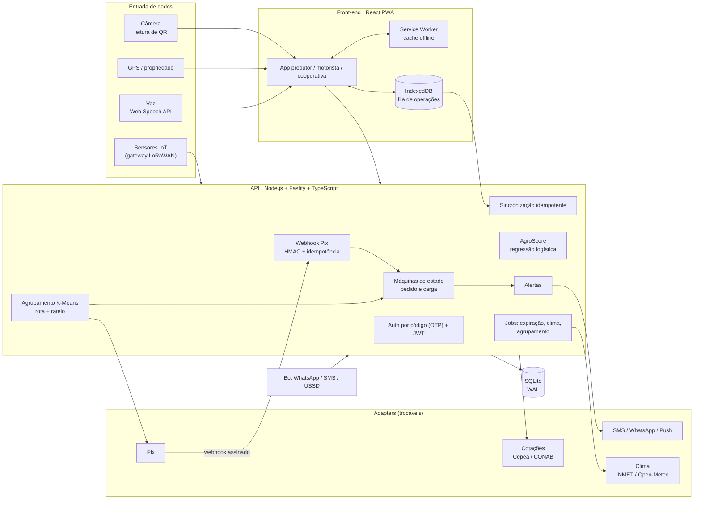
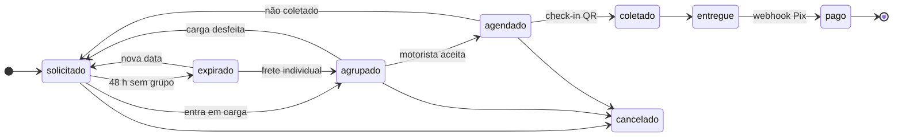
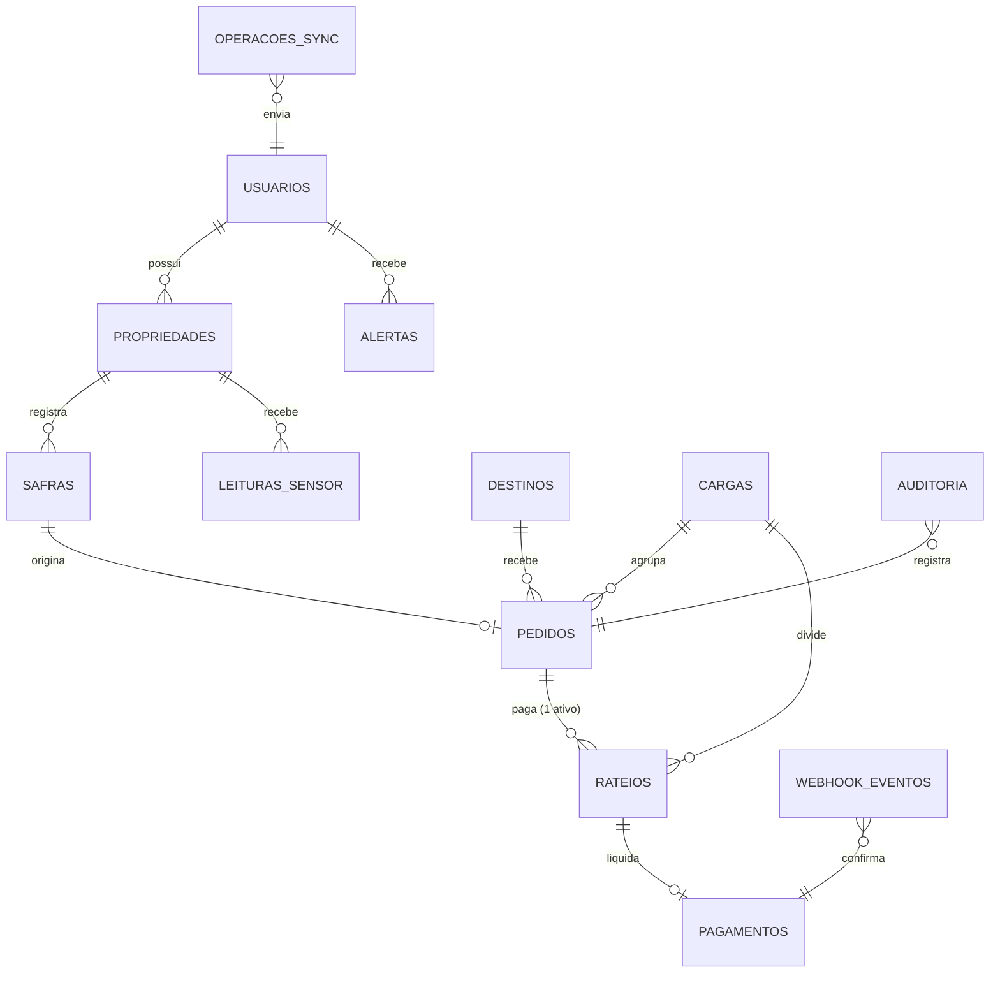
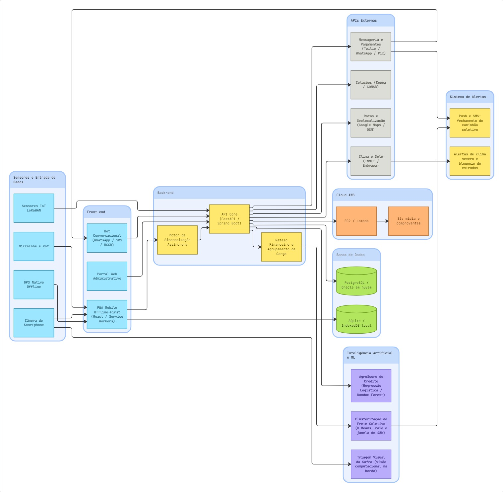

<p align="center">
  
</p>

<h1 align="center">AgroSync – CitizenTech Rural</h1>

<p align="center">
  Frete coletivo, crédito justo e alertas para pequenos produtores rurais, mesmo sem internet.<br>
  <b>Global Solution 2026.2 · FIAP · Ciência da Computação · Desafio CitizenTech</b>
</p>

<p align="center">
  🌐 <a href="https://codebynaty.github.io/agrosync/">Site do projeto</a> ·
  🧠 <a href="https://miro.com/app/board/uXjVEPeAG6Y=/?share_link_id=391462605376">Mapas mentais no Miro</a>
</p>

---

## Sumário

- [O problema](#o-problema)
- [O que o sistema faz](#o-que-o-sistema-faz)
- [Como rodar](#como-rodar)
- [Roteiro de demonstração](#roteiro-de-demonstração)
- [System design](#system-design)
- [Confiabilidade: cenários testados](#confiabilidade-cenários-testados)
- [Estrutura do código](#estrutura-do-código)
- [Simulado x real](#simulado-x-real)
- [As 8 áreas da solução](#as-8-áreas-da-solução)
- [Equipe](#equipe)

---

## O problema

No campo, a conectividade é instável, o frete individual sai caro para volumes pequenos e o crédito bancário não chega a quem não tem histórico formal. O resultado é perda de perecíveis na porteira e dependência de atravessadores.

## O que o sistema faz

| Para quem | Funcionalidade |
|---|---|
| **Produtor** | Registra a colheita por **voz** ("colhi 300 quilos de tomate") ou por **ícones**, mesmo **offline**: o registro fica no celular e sobe sozinho quando o sinal volta. |
| | Pode anexar uma **foto**: a **triagem visual** classifica o lote (Extra A, Boa B, Comercial C ou Refugo) pela cor, maturação e manchas — analisada **no próprio aparelho**, sem baixar modelo. |
| | Pede frete; o sistema junta vizinhos com o mesmo destino em até 48 h num **caminhão coletivo** e mostra quanto ele economiza. |
| | Mostra o **QR Code** para o motorista na coleta e paga sua parte do frete via **Pix**. |
| | Vê seu **AgroScore** (crédito alternativo), com os fatores que ajudam ou pesam contra. |
| | Recebe **alertas** de carga, coleta, pagamento, clima severo, estradas bloqueadas e solo seco (sensor). |
| | Usa tudo também pelo **bot** de WhatsApp / SMS / USSD, sem smartphone. |
| **Motorista** | Vê cargas disponíveis, aceita, segue a rota no mapa, faz **check-in por QR** (câmera ou código) e confirma a entrega. |
| **Cooperativa** | Painel com volumes por produto, município e mês, economia gerada, **distribuição de qualidade** das colheitas, cargas e pedidos; agrupa pedidos sob demanda; registra **bloqueios de estrada** no mapa; acompanha os webhooks Pix. |

---

## Como rodar

Requisitos: **Node.js 22.13 ou superior** (usa o SQLite nativo do Node, sem dependências nativas para compilar).

```bash
git clone https://github.com/Codebynaty/agrosync.git
cd agrosync
npm install
```

**Desenvolvimento** (API com recarga automática + front-end Vite):

```bash
npm run dev
```

- App: http://localhost:5173
- API: http://localhost:3333/api/health

**Produção** (a API serve o PWA compilado numa única porta):

```bash
npm run build
JWT_SECRET=um-segredo-longo NODE_ENV=production npm start
# abre em http://localhost:3333
```

Na primeira execução o banco é criado em `data/agrosync.db` e preenchido com ~6 meses de histórico de demonstração.
Para recriar do zero: `npm run seed -- --reset`.

**Testes:**

```bash
npm test
```

**Simulador de sensores IoT** (gateway LoRaWAN enviando umidade e temperatura, com a API rodando):

```bash
npm run sim:sensores
```

Variáveis de ambiente: veja [`.env.example`](.env.example).

### Contas de demonstração

O login é por código de 6 dígitos enviado ao celular. Na demonstração não há SMS real, então o código aparece na tela, e a tela de login tem botões "Entrar como".

| Perfil | Nome | Telefone |
|---|---|---|
| Produtora | Ana Souza (Ibiúna) | (11) 90000-0001 |
| Produtor | Benedito Lima (Ibiúna) | (11) 90000-0002 |
| Produtora | Carla Mendes (Piedade) | (11) 90000-0003 |
| Produtor | Dirceu Rocha (Mairinque) | (11) 90000-0004 |
| Produtora | Elza Nogueira (São Roque) | (11) 90000-0005 |
| Produtor | Fábio Tanaka (Cotia) | (11) 90000-0006 |
| Motorista | João Pereira | (11) 90000-0011 |
| Motorista | Marcos Silva | (11) 90000-0012 |
| Cooperativa | Cooperativa Agro Ibiúna | (11) 90000-0021 |

Todos os nomes, telefones e propriedades são fictícios.

## Roteiro de demonstração

1. **Ana (produtora)** → *Fretes*: há uma colheita de 700 kg de tomate sem frete, já com o selo **🟢 Extra (A)** da triagem visual. Toque em **Pedir frete p/ amanhã**: ela entra no caminhão coletivo que já está se formando com 4 vizinhos e o app mostra a parte dela e a economia.
2. **Triagem visual** → *Registrar colheita*: escolha o produto e toque em **Tirar ou escolher foto**. A foto é analisada no aparelho e aparece a classe (Extra/Boa/Comercial/Refugo) com as observações. Uma foto bem vermelha dá A; uma com manchas cai para C ou Refugo; uma borrada pede nova foto.
3. Ainda como Ana, em *Fretes* há uma carga entregue ontem com **Pix pendente**. Marque **Simular aviso duplicado do banco** e confirme: o pagamento é confirmado uma única vez.
4. **João (motorista)** → aceite a carga, veja a rota no mapa, faça o check-in de cada parada com o código do QR e confirme a entrega. Os produtores recebem a cobrança Pix.
5. **Cooperativa** → *Painel*: volumes, economia, **distribuição de qualidade** das colheitas e a tabela de webhooks (o duplicado aparece processado uma vez). Em *Estradas*, marque um bloqueio no mapa sobre a rota: motorista e produtores são avisados.
6. **Offline**: no Chrome, DevTools → Network → *Offline*. Registre uma colheita (pode anexar a foto): ela fica "guardada no celular" e a classe sai quando o registro sobe. Volte ao online e ela sobe sozinha, sem duplicar.
7. **Bot**: na tela de login, *Testar o bot*. Envie `colhi 200 kg de alface`, depois `frete`, `status`, `economia`, `score`.

---

## System design

### Visão geral (como implementado)



O desenho original (mapa 1) previa FastAPI/Spring, PostgreSQL/Oracle e AWS. O MVP usa uma pilha mais simples de rodar e hospedar (um processo Node + SQLite), mantendo as mesmas fronteiras: cada serviço externo fica atrás de um adapter, e o banco é acessado por SQL simples, portável para PostgreSQL.

### Offline-first

```mermaid
sequenceDiagram
    autonumber
    actor P as Produtor
    participant App as PWA
    participant F as IndexedDB (fila)
    participant API as API /sync
    participant DB as SQLite

    P->>App: registra colheita (voz ou ícones)
    App->>F: grava operação com opId e UUID da colheita
    App-->>P: "guardado no celular" (sem rede)
    Note over App,F: sem sinal: operações ficam na fila
    App->>App: evento online / a cada 20 s
    App->>API: POST /sync {operacoes}
    API->>DB: aplica cada operação; grava opId
    API-->>App: resultados (ok / erro definitivo)
    App->>F: remove as operações processadas
    Note over API,DB: reenviar o mesmo lote devolve os mesmos resultados, sem duplicar
```

### Frete coletivo

```mermaid
sequenceDiagram
    autonumber
    actor P as Produtores
    participant API as API
    participant K as Agrupamento
    actor M as Motorista
    participant PIX as Pix (adapter)

    P->>API: pedidos de frete (volume, destino, data)
    API->>K: pedidos "solicitado"
    K->>K: 1) cabe numa carga aberta? 2) K-Means por destino + janela 48 h<br/>com capacidade, raio e custo menor que o individual
    K-->>API: cargas + rota (vizinho mais próximo + 2-opt) + rateio
    API-->>P: alerta: "entrou na carga, sua parte R$ X, economia R$ Y"
    API-->>M: alerta: "nova carga disponível"
    M->>API: aceitar (só um motorista consegue)
    M->>API: check-in por QR em cada propriedade
    M->>API: entrega no destino
    API->>PIX: cobrança Pix por produtor
    PIX-->>API: webhook assinado (pix.recebido)
    API->>API: pedido → pago; todos pagos → carga liquidada
```

**Custo do frete** (parâmetros em `apps/api/src/domain/frete.ts`): taxa fixa + taxa por parada + R$/km. A distância de estrada é a distância em linha reta × 1,3.
**Rateio:** proporcional a *volume × distância até o destino*, em centavos inteiros pelo método do maior resto. Tem um teto: ninguém paga mais do que pagaria sozinho, e o excedente é redistribuído entre os demais.

### Máquinas de estado



Carga: `aberta → agendada → em_rota → entregue → liquidada` (ou `cancelada` antes da rota).
Toda transição passa por uma única função com *compare-and-set* (`UPDATE ... WHERE status = <anterior>`) e grava na tabela `auditoria`.

### Webhooks Pix idempotentes

- Corpo assinado com **HMAC-SHA256** (`x-assinatura`), conferido em tempo constante.
- `event_id` é chave primária em `webhook_eventos` e é gravado **na mesma transação** do efeito.
- Resultados possíveis: `confirmado`, `duplicado`, `ja_confirmado`, `valor_divergente`, `txid_desconhecido`. Só `confirmado` muda estado.

### AgroScore

Regressão logística treinada por gradiente descendente (implementação própria, determinística) sobre 5 sinais da operação no AgroSync: entregas concluídas, pagamentos de frete em até 72 h, volume médio, meses ativos e cancelamentos. Escala de 300 a 900, faixas A a D e limite indicativo de microcrédito. A explicação mostra o peso de cada fator. A base de treino é sintética com semente fixa; em produção, ela é trocada pelo histórico real de microcréditos.

### Triagem visual da safra

Classifica a qualidade do lote a partir de uma foto, em duas partes com uma fronteira clara (as `Caracteristicas`):

- **Percepção, no dispositivo** (`apps/web/src/triagem.ts`): o navegador lê os pixels da foto num canvas pequeno e mede sinais genéricos — fração de cada família de cor, nitidez (energia de gradiente), brilho e quanto do quadro é produto. Roda **offline, sem baixar modelo**, e não conhece a cultura.
- **Julgamento, no servidor** (`apps/api/src/domain/triagem.ts`): função **pura e determinística** que, por cultura, mapeia essas características em classe (Extra A, Boa B, Comercial C, Refugo) + maturidade, com **fatores explicáveis** (quanto cada sinal somou ou tirou), como o AgroScore. O app nunca dita a nota — a classe é sempre recalculada aqui. Fotos borradas ou com pouco produto não arriscam uma classe: pedem nova foto.

Em produção, a percepção no dispositivo é trocada por um modelo de visão computacional; o julgamento auditável permanece. A foto não é armazenada: guarda-se só uma miniatura pequena e o vetor de características.

### Modelo de dados



Garantias no próprio banco: `UNIQUE` em `pedidos(safra_id)` para pedidos ativos, em `rateios(pedido_id)` para rateios ativos, em `pagamentos(rateio_id)` e `txid`, em `alertas(chave)` (o mesmo aviso nunca é enviado duas vezes) e PK em `webhook_eventos(event_id)` e `operacoes_sync(op_id)`.

### Segurança e privacidade

| Tema | Como está |
|---|---|
| Autenticação | Login sem senha: código de 6 dígitos (hash SHA-256, 10 min, máx. 5 tentativas) + JWT de 30 dias. |
| Autorização | Cada rota exige papel (produtor, motorista, cooperativa) e confere a posse do recurso. |
| Webhooks | Assinatura HMAC verificada antes de qualquer efeito. |
| Sensores | Cada propriedade tem uma chave de dispositivo própria. |
| LGPD | Coleta mínima (nome, telefone, localização da propriedade); dados de demonstração fictícios; o cache offline é apagado ao sair. |
| Acessibilidade | Voz, ícones grandes, alvos de toque ≥ 48 px, alto contraste, modo escuro, canais SMS/USSD. |

---

## Confiabilidade: cenários testados

`npm test` roda **72 testes automatizados** (Vitest). Todos passam.

| Área | Cenário | Resultado esperado |
|---|---|---|
| Dinheiro | Rateio de centavos com qualquer conjunto de pesos | Soma exatamente o total, sem centavo perdido ou criado |
| Dinheiro | Teto do rateio | Ninguém paga mais do que no frete individual |
| Frete | Carga coletiva × fretes individuais | Coletivo sempre mais barato, senão o grupo não é formado |
| Agrupamento | Mesmo conjunto de pedidos | Mesmos grupos (K-Means determinístico) |
| Agrupamento | Capacidade, raio, destino e janela de 48 h | Nenhum grupo viola as restrições |
| Agrupamento | Pedido novo com carga aberta compatível | Entra na carga e o rateio é refeito |
| Agrupamento | Carga já aceita por motorista | Não é alterada |
| Estados | Pular etapas ou voltar de estado terminal | Recusado |
| Concorrência | Dois motoristas aceitam a mesma carga | Um consegue (200), o outro recebe 409 |
| Offline | Mesmo lote de sincronização enviado duas vezes | Nada duplicado; resultado marcado como repetido |
| Offline | Operação inválida no meio do lote | As demais são aplicadas |
| Offline | Dois pedidos para a mesma colheita | Devolve o pedido existente |
| Pix | Webhook duplicado | Confirma uma única vez |
| Pix | Outro evento para pagamento já confirmado | Ignorado (`ja_confirmado`) |
| Pix | Valor diferente do cobrado | Não confirma |
| Pix | Assinatura inválida | 401 |
| Pix | Todos os produtores pagam | Carga liquidada e motorista avisado |
| Coleta | QR de outra carga | Recusado |
| Coleta | Produtor ausente | Volta para a fila e não é cobrado |
| Cancelamento | Produtor sai de carga com 3 | Carga replanejada para os outros 2, com rateio refeito |
| Auth | Código errado 5 vezes | Bloqueia (429) |
| Auth | Rota de outro papel | 403 |
| Linguagem | "trezentos e cinquenta quilos de alface", "10 caixas de morango", "2 toneladas de milho"... | Interpretado corretamente; frase sem quantidade não é inventada |
| AgroScore | Mais pontualidade / mais cancelamentos | Score sobe / desce (monotonicidade) |
| Triagem | Mais manchas na foto | Pontuação cai sempre (monotonicidade) |
| Triagem | Verde é imaturo na fruta, mas é o ponto certo na folhosa | Classificação coerente por cultura |
| Triagem | Foto borrada ou com pouco produto | Pede nova foto; não arrisca uma classe |
| Triagem | Mesma foto → mesma classe; app não dita a nota | Determinística e recalculada no servidor |
| Sensores | Solo seco duas vezes no mesmo dia | Um único alerta |
| Datas | Virada de mês, de ano e 29/02 | Corretas |
| Seed | Histórico completo de demonstração | Todo rateio soma o custo da sua carga |

---

## Estrutura do código

```
agrosync/
├── apps/
│   ├── api/                  Node.js + Fastify + TypeScript
│   │   ├── src/domain/       regras puras: geo, frete, agrupamento, rateio, estados, AgroScore, triagem visual, linguagem
│   │   ├── src/services/     casos de uso: fretes, pagamentos, sync, alertas, bot, jobs, painel
│   │   ├── src/adapters/     Pix, notificação, clima, cotações (simulados + Open-Meteo real)
│   │   ├── src/routes.ts     rotas HTTP /api/*
│   │   ├── src/seed.ts       dados de demonstração gerados pelos próprios serviços
│   │   └── test/             testes de domínio e de fluxo (HTTP em memória)
│   └── web/                  React + Vite + PWA (Workbox) + Leaflet
│       └── src/              offline.ts (fila IndexedDB), páginas por papel, componentes
└── docs/                     site de apresentação (GitHub Pages)
```

## Simulado x real

| Integração | No MVP | Para produção |
|---|---|---|
| Pix | Sandbox próprio, fiel ao contrato de um PSP: cobrança, webhook assinado e opção de duplicar | Implementar `ProvedorPix` com um PSP (ex.: Asaas, iugu, Efí) |
| SMS / WhatsApp / Push | Caixa de saída simulada (`/api/dev/caixa-saida`) | Implementar `Notificador` com Twilio / WhatsApp Business / Web Push |
| Clima | Simulador determinístico; **Open-Meteo real** com `CLIMA_PROVIDER=open-meteo` | INMET |
| Cotações | Simuladas sobre preços de referência | Cepea / CONAB |
| Sensores | Simulador de gateway (`npm run sim:sensores`) | Gateway LoRaWAN real chamando `POST /api/sensores/leituras` |
| Voz | Web Speech API do navegador (precisa de internet) | — |
| Triagem visual da safra | Percepção da foto no dispositivo (cor, nitidez, cobertura) + classificação determinística por cultura no servidor | Trocar a percepção por um modelo de visão computacional no aparelho; as `Caracteristicas` seguem sendo a fronteira |
| Power BI | Substituído pelo painel da cooperativa no próprio app | — |

**Ambiente de demonstração: nenhum dinheiro real é movimentado.**

---

## As 8 áreas da solução

| # | Área | Onde está no código |
|---|---|---|
| 1 | Coleta de dados e identificação de necessidades | `web/pages/produtor/Colheita.tsx`, `web/triagem.ts` (foto no dispositivo), `web/offline.ts`, `api/services/bot.ts`, `api/simulador-sensores.ts` |
| 2 | Processamento e análise de dados | `api/services/painel.ts`, `api/domain/geo.ts` |
| 3 | Inteligência artificial e ML | `api/domain/agrupamento.ts` (K-Means), `api/domain/agroscore.ts` (regressão logística), `api/domain/triagem.ts` (triagem visual), `api/domain/linguagem.ts` |
| 4 | Geração de alertas e notificações | `api/services/alertas.ts`, `api/services/jobs.ts`, `api/services/bloqueios.ts` |
| 5 | Dashboards e visualização | `web/pages/produtor/Inicio.tsx`, `web/pages/cooperativa/Painel.tsx` |
| 6 | Gerenciamento e atendimento das demandas | `api/services/fretes.ts`, `api/services/pagamentos.ts`, `web/pages/motorista/*` |
| 7 | Integração entre sistemas e serviços | `api/adapters/*`, `api/routes.ts` |
| 8 | Acessibilidade, privacidade e segurança | `api/services/auth.ts`, `web/estilo.css`, fluxo por voz e bot USSD/SMS |

### Mapas mentais

<details>
<summary>Mapa 1 · Arquitetura geral</summary>


</details>

<details>
<summary>Mapa 2 · Divisão das áreas</summary>


</details>

## Equipe

- Raissa Marinho

## Licença

Distribuído sob a licença MIT. Veja [LICENSE](LICENSE).
