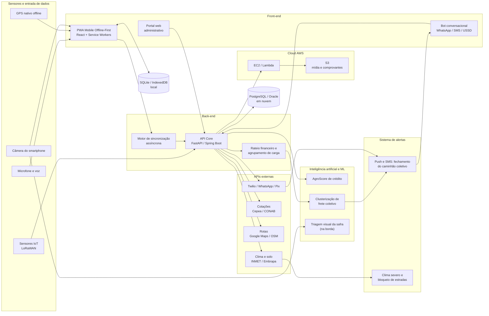
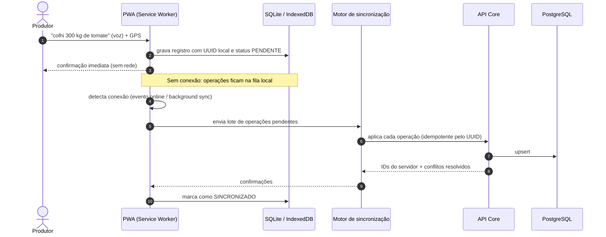
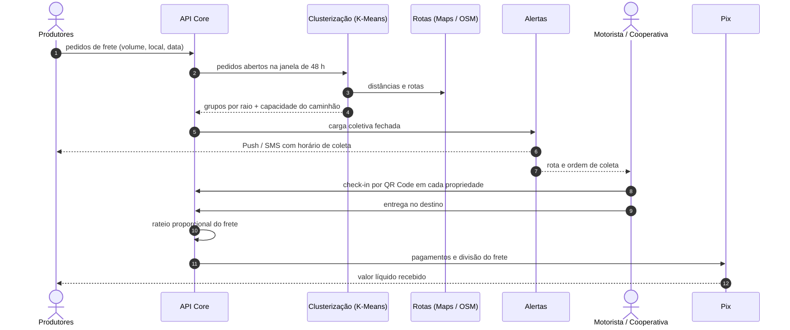
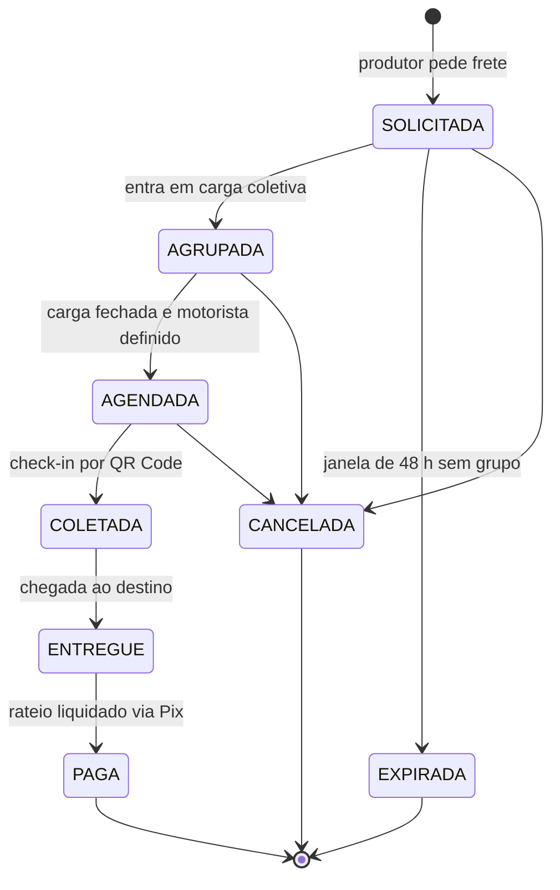
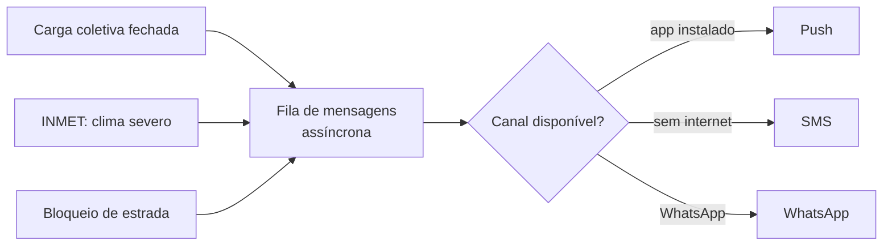
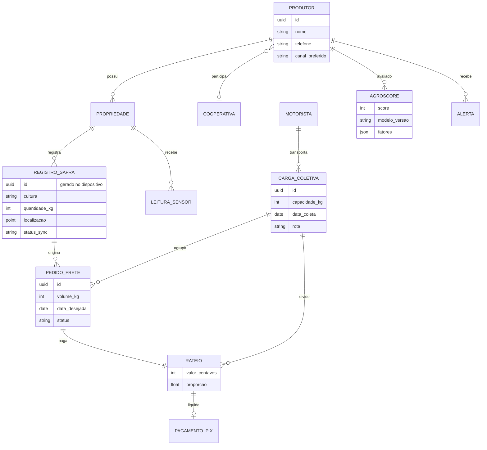

  

<h1 align="center">AgroSync – CitizenTech Rural</h1>

  Frete coletivo, crédito justo e alertas para pequenos produtores rurais, mesmo sem internet. 
  <b>Global Solution 2026.2 · FIAP · Ciência da Computação · Desafio CitizenTech</b>

  🌐 <a href="https://codebynaty.github.io/agrosync/">Site do projeto</a> ·
  🧠 <a href="https://miro.com/app/board/uXjVEPeAG6Y=/?share_link_id=391462605376">Mapas mentais no Miro</a>

---

## Sumário

- [O problema](#o-problema)
- [A solução](#a-solução)
- [System design](#system-design)
  - [Visão geral da arquitetura](#visão-geral-da-arquitetura)
  - [Componentes por camada](#componentes-por-camada)
  - [Sincronização offline-first](#sincronização-offline-first)
  - [Frete coletivo: do registro ao pagamento](#frete-coletivo-do-registro-ao-pagamento)
  - [Ciclo de vida da ordem de coleta](#ciclo-de-vida-da-ordem-de-coleta)
  - [Inteligência artificial](#inteligência-artificial)
  - [Sistema de alertas](#sistema-de-alertas)
  - [Modelo de dados](#modelo-de-dados)
  - [Segurança, privacidade e acessibilidade](#segurança-privacidade-e-acessibilidade)
  - [Decisões técnicas](#decisões-técnicas)
- [As 8 áreas da solução](#as-8-áreas-da-solução)
- [Mapas mentais](#mapas-mentais)
- [Site do projeto](#site-do-projeto)
- [Equipe](#equipe)
- [Licença](#licença)

---

## O problema

No campo, a conectividade é instável, o frete individual sai caro para volumes pequenos e o crédito bancário não chega a quem não tem histórico formal. O resultado é perda de perecíveis na porteira e dependência de atravessadores.

## A solução

O **AgroSync** é uma plataforma *offline-first* que permite ao pequeno produtor:

- registrar a colheita em **menos de 1 minuto**, por voz ou ícones, sem 4G;
- dividir o caminhão com vizinhos (frete coletivo por IA), com **até 60% de economia**;
- receber o rateio do frete e os pagamentos via **Pix**;
- acessar **microcrédito** pelo AgroScore, um modelo de risco alternativo;
- receber **alertas** de fechamento de carga, clima severo e bloqueio de estradas.

Alinhado aos **ODS 2** (Fome Zero) e **ODS 12** (Consumo e Produção Responsáveis).

---

## System design

### Visão geral da arquitetura

### Componentes por camada

| Camada | Componente | Responsabilidade |
|---|---|---|
| **Entrada de dados** | Sensores IoT LoRaWAN | Telemetria de longo alcance e baixo consumo (umidade, temperatura) em áreas sem 4G. |
| | Microfone e voz | Registro da colheita falado, para produtores com baixa escolaridade. |
| | GPS nativo offline | Localização da propriedade e do ponto de coleta, sem depender de rede. |
| | Câmera | Fotos da safra para triagem visual e comprovantes. |
| **Front-end** | PWA Offline-First (React + Service Workers) | App principal do produtor; funciona sem internet e guarda tudo localmente. |
| | Bot conversacional (WhatsApp / SMS / USSD) | Canal para qualquer celular, inclusive sem smartphone. |
| | Portal web administrativo | Uso por cooperativas, motoristas e prefeituras. |
| **Back-end** | API Core (FastAPI / Spring Boot) | Regras de negócio, autenticação e orquestração das integrações. |
| | Motor de sincronização assíncrona | Recebe filas de operações feitas offline e reconcilia com o servidor. |
| | Rateio financeiro e agrupamento de carga | Divide o custo do frete proporcionalmente e monta as cargas coletivas. |
| **Dados** | PostgreSQL / Oracle em nuvem | Fonte da verdade (produtores, safras, ordens, pagamentos). |
| | SQLite / IndexedDB local | Cópia local e fila de sincronização no dispositivo. |
| **Nuvem (AWS)** | EC2 / Lambda | Execução da API e de tarefas por evento. |
| | S3 | Armazenamento de fotos, áudios e comprovantes. |
| **IA / ML** | AgroScore, K-Means, visão computacional | Ver [Inteligência artificial](#inteligência-artificial). |
| **Integrações** | Twilio / WhatsApp / Pix, Cepea / CONAB, Google Maps / OSM, INMET / Embrapa | Mensageria, pagamentos, cotações, rotas e clima. |
| **Alertas** | Push e SMS | Avisos de carga, clima e estradas. |

### Sincronização offline-first

O produtor nunca espera a rede. Toda ação é gravada primeiro no dispositivo e enviada depois.

- Cada registro nasce com um **UUID gerado no dispositivo**. Reenviar o mesmo lote não duplica dados.
- Conflitos são resolvidos no servidor. O dado mais recente vence para campos simples, e operações financeiras nunca são sobrescritas: são reconciliadas.
- Mídias (fotos e áudios) sobem separadas, direto para o S3, quando houver conexão melhor.

### Frete coletivo: do registro ao pagamento

### Ciclo de vida da ordem de coleta

Um pedido expirado pode ser reaberto ou atendido por frete individual.

### Inteligência artificial

| Modelo | Técnica | Entrada | Saída | Para quê |
|---|---|---|---|---|
| **Clusterização de frete coletivo** | K-Means com restrição de raio e janela de 48 h | Localização, volume, data desejada, capacidade do caminhão | Grupos de coleta e sequência de rota | Reduzir o custo do frete em até 60% |
| **AgroScore de crédito** | Regressão Logística / Random Forest (Scikit-learn) | Histórico de colheitas, entregas concluídas, regularidade de pagamentos, dados de clima e mercado | Score de risco e explicação dos fatores | Microcrédito justo sem histórico bancário formal |
| **Triagem visual da safra** | Visão computacional rodando no dispositivo (borda) | Foto da produção | Classificação de qualidade / perecibilidade | Priorizar perecíveis e reduzir perdas, sem depender de rede |

Cuidados: o AgroScore deve ser explicável ao produtor, revisado contra vieses regionais e nunca negar crédito sem possibilidade de revisão humana.

### Sistema de alertas

As mensagens são curtas, de baixo consumo de dados, e caem para SMS quando não há internet.

### Modelo de dados

### Segurança, privacidade e acessibilidade

| Tema | Medida |
|---|---|
| **LGPD** | Coleta mínima, consentimento explícito, finalidade clara e direito de exclusão. |
| **Criptografia** | TLS em trânsito; dados sensíveis cifrados em repouso no servidor e no dispositivo. |
| **Autenticação** | Login simplificado (código por SMS / WhatsApp), sem senha complexa. |
| **Acessibilidade** | Interface voice-first, ícones grandes e alto contraste para uso sob sol. |
| **Inclusão** | Canais USSD e SMS para quem não tem smartphone ou plano de dados. |

### Decisões técnicas

| Tema | Decisão |
|---|---|
| **Offline-first** | O dispositivo é a primeira fonte de escrita; o servidor reconcilia. |
| **Idempotência** | UUID gerado no dispositivo em todo registro e operação sincronizada. |
| **Dinheiro** | Valores em centavos inteiros no rateio e nos pagamentos. |
| **Geoespacial** | Consultas espaciais em SQL para raio de coleta e volumes por região. |
| **ETL** | Pipeline em Python (Pandas / NumPy) para limpar e cruzar dados de campo, clima, rotas e mercado. |
| **Integrações** | API Gateway RESTful para INMET, mapas, ERPs de cooperativas e Pix. |
| **Mídia** | Upload direto para S3, desacoplado da sincronização dos dados. |
| **Analytics** | Dashboard em Power BI para cooperativas e prefeituras (volumes, renda, ODS 2/12, PNAE). |

---

## As 8 áreas da solução

| # | Área | Função | O que será desenvolvido | Objetivo |
|---|---|---|---|---|
| 1 | Coleta de dados e identificação de necessidades | Captar dados de safra e demanda de frete no campo, mesmo sem internet | Caderno de campo PWA offline-first por voz/ícones, bot SMS/WhatsApp e GPS | Registrar a colheita em menos de 1 minuto sem depender de 4G |
| 2 | Processamento e análise de dados | Higienizar, validar e cruzar dados do campo com clima, rotas e mercado | Pipeline ETL em Python (Pandas/NumPy) e consultas geoespaciais em SQL | Transformar registros isolados em inteligência logística e volumes por região |
| 3 | Inteligência artificial e ML | Otimizar o compartilhamento de caminhões e calcular risco de crédito alternativo | K-Means para pool de frete e modelo preditivo AgroScore (Scikit-learn) | Reduzir o frete em até 60% e viabilizar microcrédito sem burocracia |
| 4 | Geração de alertas e notificações | Sincronizar produtores, motoristas e cooperativas sobre janelas de coleta e clima | Motor de mensageria assíncrona com SMS e WhatsApp de baixo consumo | Garantir o embarque no momento certo e zerar perdas de perecíveis |
| 5 | Dashboards e visualização | Transparência financeira ao produtor e visão analítica a cooperativas e prefeituras | Tela de ganhos/economia no app e dashboard em Power BI (volumes, renda, ODS 2/12) | Fortalecer o produtor frente a atravessadores e embasar políticas públicas (PNAE) |
| 6 | Gerenciamento e atendimento das demandas | Orquestrar o ciclo do pedido de frete até a entrega e o pagamento | Ordens de coleta, check-in via QR Code, rateio automático via Pix e suporte | Rastreabilidade ponta a ponta e divisão justa do frete |
| 7 | Integração entre sistemas e serviços | Conectar a ecossistemas governamentais, meteorológicos, logísticos e bancários | API Gateway RESTful integrando INMET, mapas rurais, ERPs de cooperativas e Pix | Operar como hub automatizado sem preenchimento técnico do agricultor |
| 8 | Acessibilidade, privacidade e segurança | Inclusão digital no campo e proteção de dados | Interface voice-first com alto contraste, login simplificado e criptografia (LGPD) | Uso autônomo por produtores com baixa escolaridade ou visão reduzida |

## Mapas mentais

**Mapa 1 · Arquitetura geral**

**Mapa 2 · Divisão das áreas**

## Site do projeto

A página do projeto é estática (`index.html` + `assets/`), sem etapa de build, publicada em **https://codebynaty.github.io/agrosync/**. Para ver localmente, abra o `index.html` no navegador.

## Equipe

- Raissa Marinho

## Licença

Distribuído sob a licença MIT. Veja [LICENSE](LICENSE).
