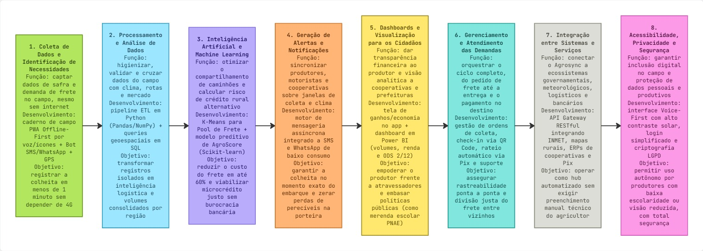

  

<h1 align="center">AgroSync – CitizenTech Rural</h1>

  Frete coletivo, crédito justo e alertas para pequenos produtores rurais, mesmo sem internet. 
  <b>Global Solution 2026.2 · FIAP · Ciência da Computação · Desafio CitizenTech</b>

---

## Sobre o projeto

No campo, a conectividade é instável, o frete individual sai caro e o crédito bancário não chega a quem não tem histórico formal. O resultado é perda de perecíveis na porteira e dependência de atravessadores.

O **AgroSync** é uma plataforma *offline-first* que permite ao produtor:

- registrar a colheita em **menos de 1 minuto**, por voz ou ícones, sem 4G;
- dividir o caminhão com vizinhos (frete coletivo por IA), com **até 60% de economia**;
- receber o rateio do frete e os pagamentos via **Pix**;
- acessar **microcrédito** com o AgroScore, um modelo de risco alternativo;
- receber **alertas** de fechamento de carga, clima severo e bloqueio de estradas.

Alinhado aos **ODS 2** (Fome Zero) e **ODS 12** (Consumo e Produção Responsáveis).

🔗 **Mapas mentais no Miro:** https://miro.com/app/board/uXjVEPeAG6Y=/?share_link_id=391462605376

## Arquitetura geral

| Camada | Componentes |
|---|---|
| **Sensores e entrada de dados** | Sensores IoT LoRaWAN, microfone/voz, GPS nativo offline, câmera do smartphone |
| **Front-end** | PWA Mobile Offline-First (React + Service Workers), bot conversacional (WhatsApp / SMS / USSD), portal web administrativo |
| **Back-end** | API Core (FastAPI / Spring Boot), motor de sincronização assíncrona, rateio financeiro e agrupamento de carga |
| **Banco de dados** | PostgreSQL / Oracle em nuvem; SQLite / IndexedDB local |
| **IA e ML** | AgroScore de crédito (Regressão Logística / Random Forest), clusterização de frete coletivo (K-Means, raio + janela de 48 h), triagem visual da safra (visão computacional na borda) |
| **Nuvem (AWS)** | EC2 / Lambda, S3 para mídia e comprovantes |
| **APIs externas** | Twilio / WhatsApp / Pix, Cepea / CONAB, Google Maps / OSM, INMET / Embrapa |
| **Sistema de alertas** | Push e SMS de fechamento do caminhão coletivo; alertas de clima severo e bloqueio de estradas |

## Divisão das áreas da solução

| # | Área | Função | O que será desenvolvido | Objetivo |
|---|---|---|---|---|
| 1 | Coleta de dados e identificação de necessidades | Captar dados de safra e demanda de frete no campo, mesmo sem internet | Caderno de campo PWA offline-first por voz/ícones, bot SMS/WhatsApp e GPS | Registrar a colheita em menos de 1 minuto sem depender de 4G |
| 2 | Processamento e análise de dados | Higienizar, validar e cruzar dados do campo com clima, rotas e mercado | Pipeline ETL em Python (Pandas/NumPy) e consultas geoespaciais em SQL | Transformar registros isolados em inteligência logística e volumes por região |
| 3 | Inteligência artificial e ML | Otimizar o compartilhamento de caminhões e calcular risco de crédito alternativo | K-Means para pool de frete e modelo preditivo AgroScore (Scikit-learn) | Reduzir o frete em até 60% e viabilizar microcrédito sem burocracia |
| 4 | Geração de alertas e notificações | Sincronizar produtores, motoristas e cooperativas sobre janelas de coleta e clima | Motor de mensageria assíncrona com SMS e WhatsApp de baixo consumo | Garantir o embarque no momento certo e zerar perdas de perecíveis |
| 5 | Dashboards e visualização | Transparência financeira ao produtor e visão analítica a cooperativas e prefeituras | Tela de ganhos/economia no app e dashboard em Power BI (volumes, renda, ODS 2/12) | Fortalecer o produtor frente a atravessadores e embasar políticas públicas (PNAE) |
| 6 | Gerenciamento e atendimento das demandas | Orquestrar o ciclo do pedido de frete até a entrega e o pagamento | Ordens de coleta, check-in via QR Code, rateio automático via Pix e suporte | Rastreabilidade ponta a ponta e divisão justa do frete |
| 7 | Integração entre sistemas e serviços | Conectar a ecossistemas governamentais, meteorológicos, logísticos e bancários | API Gateway RESTful integrando INMET, mapas rurais, ERPs de cooperativas e Pix | Operar como hub automatizado sem preenchimento técnico do agricultor |
| 8 | Acessibilidade, privacidade e segurança | Inclusão digital no campo e proteção de dados | Interface voice-first com alto contraste, login simplificado e criptografia (LGPD) | Uso autônomo por produtores com baixa escolaridade ou visão reduzida |

## Site do projeto

A página do projeto é estática (`index.html` + `assets/`), sem etapa de build. Para ver localmente, basta abrir o `index.html` no navegador. Ela também é publicada via GitHub Pages.

## Equipe

- Natalia Alcantara
- Raissa Marinho
- Vitoria Oliveiro
